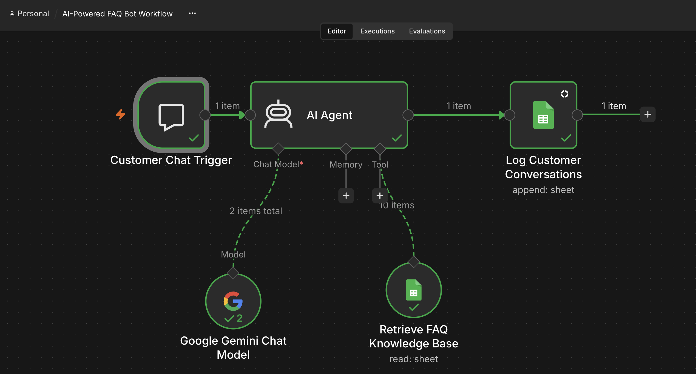
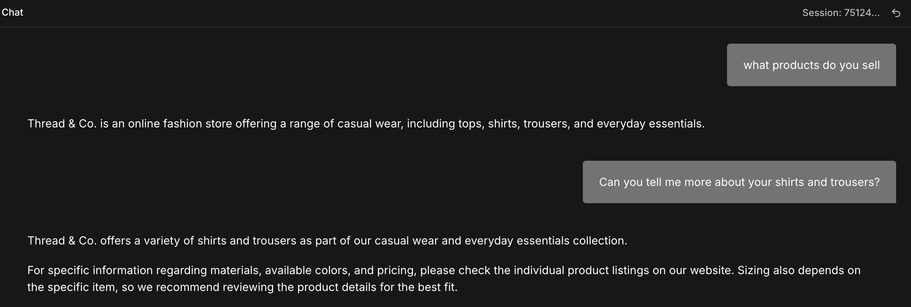
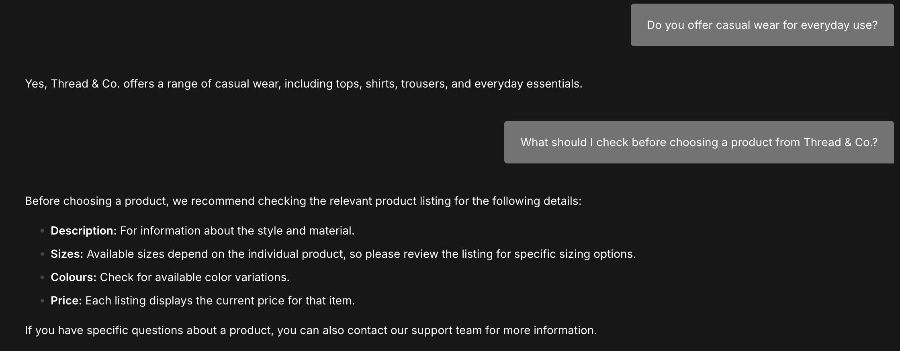

# 🤖 AI-Powered FAQ Chatbot

An AI-powered customer support chatbot built with **n8n, Google Gemini, and Google Sheets** for Thread & Co., a fictional online fashion store. The workflow retrieves FAQ information, generates conversational answers, and logs customer interactions automatically.

## ✨ Features

- **AI-Powered Responses:** Uses Google Gemini to generate natural-language answers.
- **FAQ Knowledge Retrieval:** Fetches relevant store information from Google Sheets.
- **Grounded Answers:** Instructs the AI to avoid inventing prices, availability, delivery details, or store policies.
- **Conversation Logging:** Records timestamps, customer questions, bot responses, session IDs, and response sources in Google Sheets.
- **Automated Workflow:** Connects chat input, AI processing, FAQ retrieval, and conversation logging through n8n.

## ⚙️ Workflow

1. **Customer Chat Trigger** — Receives customer questions.
2. **FAQ Assistant Agent** — Processes questions and coordinates the response.
3. **Gemini Chat Model** — Generates the answer.
4. **FAQ Knowledge Base** — Retrieves relevant information from Google Sheets.
5. **Conversation Logging** — Stores interaction details in a separate worksheet.

## 🖼️ Screenshots

### 1. Workflow Architecture

### 2. Chatbot Responses
 

### 3. Activity Log

## 🛠️ Tech Stack

- **n8n** — Workflow automation
- **Google Gemini** — AI response generation
- **Google Sheets** — FAQ database and conversation logging
- **JSON** — Workflow configuration

## 💬 Example Questions

- What products do you sell?
- Can you tell me more about your shirts and trousers?
- Do you offer casual wear for everyday use?
- What should I check before choosing a product?

## 🔐 Notes

- Built as a demonstration using a fictional fashion store.
- Requires separately configured Gemini and Google Sheets credentials.
- Does not support live order tracking, payments, refunds, or order modifications.
- Response accuracy depends on the information available in the FAQ database.
